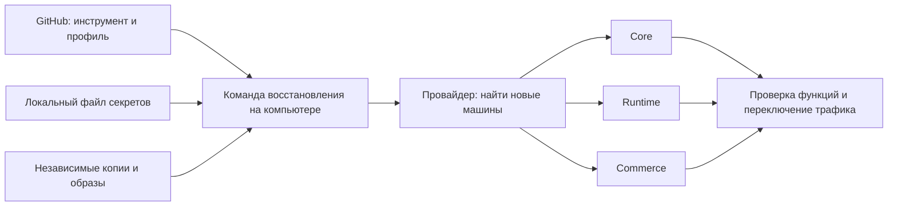

# Восстановление Yleum на новых серверах

Статус: проект системы для согласования. Команда ниже описывает целевой интерфейс;
готового исполнительного инструмента и полного проверенного комплекта пока нет.
Исходный код проверен на `c035581877749ea1b7989fd0b5f91eac8cf6abfe`.
Production не изменяется: действует поручение работать через GitHub.

## Что получает владелец

После потери серверов владелец предоставляет новые вычислительные мощности и
говорит агенту: **«Подтяни и восстанови Yleum»**. Агент использует один локальный
профиль с секретами, сам обнаруживает машины и восстанавливает систему. Владелец
не вводит IP, не правит сетевые интерфейсы, `.env`, сертификаты и адреса сервисов.

Целевой вызов:

```text
yleum recover --profile cortel
```

Профиль выбирается один раз на компьютере. Слова «подтяни» означают получение
инструмента восстановления; саму платформу восстанавливаем из **последнего
проверенного выпуска**, связанного с резервной копией. Новый `main` не становится
автоматически совместимым выпуском только потому, что он есть в GitHub.

Сохраняем текущие роли `core`, `runtime`, `commerce`. Перенос системы не меняет
проектов, владельцев, доменов MAX, привязок ботов и правил доступа к данным.

## Три части комплекта

| Часть | Где находится | Содержание |
| --- | --- | --- |
| Инструмент и публичный профиль | GitHub | Скрипты, схема ролей, версия формата, ссылка на логический профиль `cortel`, проверенные версии и инструкция агенту. Без рабочих секретов и персональных данных. |
| Файл с секретами | Компьютеры владельца | Один переносимый зашифрованный файл `cortel.yleum-recovery`: доступ к провайдеру, SSH, DNS, внешнему хранилищу и GitHub; ключ расшифровки резервных копий; полный экспорт действующих секретов всех трёх ролей. |
| Данные и готовые образы | Независимое хранилище вне тройки VPS | Полные зашифрованные точки восстановления, журналы изменений, исходники, объекты, рабочие тома и набор образов проверенного выпуска. Компьютер не обязан хранить сотни гигабайт постоянно. |

В GitHub ссылка имеет вид **`local-profile:cortel`**, который инструмент разрешает
через `YLEUM_RECOVERY_HOME` на текущем компьютере. Это идентификатор профиля,
а не публичная ссылка скачивания секретов и не путь с именем конкретного
пользователя Windows. Большие архивы адресуются по идентификатору и контрольной
сумме из манифеста; секретные ссылки доступа в Git не записываются.

Сам файл секретов защищён переносимым способом разблокировки. На каждом
доверенном компьютере профиль один раз активируется через локальное защищённое
хранилище; далее агент получает секреты без пересылки в чат. Ключ разблокировки
не хранится открытым внутри того же файла. Есть проверенная независимая копия
файла и способ разблокировки на случай потери основного компьютера.



## Как исчезает ручная работа с IP

Провайдерский адаптер получает из локального профиля аккаунт, область поиска
и метку новой группы машин. Через подтверждённый API он находит уже выданные
серверы, их идентификаторы, адреса, архитектуру, CPU, память и диски. Роли
определяются по меткам `yleum-role=core|runtime|commerce` внутри одной группы.
Если провайдер не поддерживает метки, сохраняется соответствие роли и постоянного
ID **новой целевой машины**: эти ID регистрируются при выдаче новой группы,
без ввода IP. Это отдельные provider instance IDs, не идентификаторы утраченных
серверов и не сохраняемые логические host IDs из резервной копии. Адрес новой
машины всё равно определяется автоматически.

Несколько подходящих групп или недостаточные права дают понятный отказ до
изменения серверов. Инструмент не выбирает случайные машины из аккаунта. Первое
выполнение не покупает VPS и не переустанавливает занятые серверы: пользователь
уже предоставил мощности; новые цели проверяются как пустые и принадлежащие
нужной группе. При полной потере прежних узлов их выключение или блокировка
через управление провайдера подтверждается до активации новых писателей.

Внутренний обнаруженный инвентарь содержит реальные адреса, но является
результатом работы адаптера. Из него автоматически формируются SSH-алиасы,
служебные имена, приватные маршруты, доступ к PostgreSQL, firewall, публикация
и конфигурация сервисов. Приложения обращаются к логическим сервисам, а не к
адресам старых VPS. Имя сетевого интерфейса и MTU обнаруживаются на цели;
наличие Serverum LAN или интерфейса `enp2s0` не предполагается.

Сохраняются логические идентификаторы хостов, которыми уже связаны ячейки
проектов. Замена физической машины не требует менять владельца проекта или
подставлять новый host ID во все строки БД. Проверка SSH удостоверяет новые
машины через доверенный канал провайдера; проверка ключа хоста не отключается.

Новые кластеры и сетевые службы создаются из проверенных манифестов; старые
физические адреса и идентификаторы K3s не копируются вслепую. Инфраструктурные
сертификаты, kubeconfig и endpoint-ссылки перегенерируются для новых целей,
а тома возвращаются к прежним логическим проектам. Ключи шифрования данных,
токены интеграций и прикладные идентификаторы при этом сохраняются.

Для другого провайдера меняется адаптер и локальный профиль. Первый выпуск
поддерживает совместимые Linux x86_64 машины; другие архитектуры допускаются
только при наличии полного проверенного набора соответствующих образов.

## Что именно должно пережить потерю трёх серверов

Манифест точки восстановления включает все три роли и каждый проект:

- Платформенную БД, роли PostgreSQL, БД ячеек и опубликованных приложений,
  бизнес-записи, владельцев и связи.
- Исходники и принятые версии, файлы MinIO, загрузки, приватные черновики,
  workspace/home/checkpoint volumes, пользовательские тома и PVC.
- Файлы окружений и эффективные параметры каждой роли, systemd units,
  доверенные сертификаты, конфигурацию публикации и сетевую топологию.
- Состояние оркестраторов, привязки хостов, fencing epochs, очереди и журналы
  генераций, биллинга и интеграций.
- Полный набор образов и артефактов среды: API, web, gateway, billing,
  оркестраторы, machine/guard/core/helper/PostgreSQL/Redis. Ссылки по digest
  должны открываться без старого реестра runtime; одного локального тега `prod`
  или метаданных K3s недостаточно.

Хранятся точный release SHA, версия схемы БД, хеши архивов, перечень обязательных
томов и идентификатор экспорта секретов. Для непрерывной копии манифест связывает
границы транзакций/LSN каждой БД, последовательности файловых изменений и версии
объектов с общей проверенной границей восстановления. Все необходимые журналы
до этой границы должны быть долговечно сохранены вне потерянных серверов.
Исходные ключи шифрования сохраняются:
генерация нового JWT или `SECRETS_ENCRYPTION_KEY` при восстановлении может
сделать сохранённые интеграционные credentials нечитаемыми.

Полная точка не принимает `partial`, `deferred`, неизвестные или пропущенные
обязательные тома. Оптимизации для восстанавливаемых кешей разрешаются только
при явной классификации; исходники и приватный черновик кешами не считаются.
Регистры сетевых адресов перегенерируются, смысловые настройки генерации,
моделей, admission, таймаутов и биллинга сверяются с сохранённым выпуском.

Проверенный перенос сохраняет все подтверждённые бизнес-записи. Для внезапной
потери всей тройки это требует независимой непрерывной копии авторитетных
записей: DB/WAL и связанных объектов с общей границей восстановления.
Обычная ночная копия гарантирует восстановление только до её зафиксированного
момента. Режим без потери подтверждённых записей считается готовым лишь после
проверки внешней долговечности до подтверждения записи клиенту; иначе манифест
честно сообщает возможное окно потери. Покупка внешних услуг в этот проект
согласования не входит.

## Порядок одной команды

1. Разблокировать профиль, проверить доступ к GitHub, управлению мощностями,
   независимым архивам и входному маршруту. Выбрать последнюю полную проверенную
   точку восстановления, общую долговечную границу журналов и совместимый выпуск.
   Создать recovery run ID либо найти его для продолжения; получить исключительное
   право операции во внешнем журнале, доступном после потери компьютера и VPS.
2. Обнаружить три назначенные цели, проверить их принадлежность, ресурсы,
   диски, OS/архитектуру, связь и доверенные ключи. Новый запуск требует пустых
   целей и закрепляет их provider/instance IDs в своём журнале. Продолжение
   допускает непустую цель только с подтверждённым состоянием того же recovery
   run ID и тех же машин; чужую занятую цель оно не изменяет. Отсутствие старых
   серверов или их registry не является зависимостью восстановления.
3. Параллельно подготовить роли: пользователей, пакеты нужных версий, сеть,
   Docker/K3s там, где требуется, PostgreSQL и служебные конфигурации.
4. Скачать готовые образы и архивы, проверить целостность, восстановить
   секреты, БД, объекты и файловые тома. Применить WAL/журналы изменений до общей
   внешней долговечной границы, сверить LSN/версии объектов и межкомпонентные
   связи. Без полной цепочки или доказанной согласованности открытие записи
   запрещено. Миграции не выбираются по случайному текущему `main`;
   применяется совместимый сохранённый выпуск.
5. Проверить отсутствие второго владельца записи, обновить fencing epoch и
   назначить восстановленную группу единственной целью будущего открытия записи.
   Production workers, входящие изменения, биллинг и интеграционные callbacks
   пока закрыты. QA выполняется в отдельной проверочной среде с разрешёнными
   QA admission/workers и синтетическими данными; её записи не включаются
   в производственную точку восстановления.
6. Запустить роли и проверить версии, образы, конфигурацию, сохранность записей,
   вход, проекты, preview, сохранение, генерацию, восстановление версии,
   публикацию MAX и доступ к интеграциям на выделенных QA-данных. Для внешних
   действий нужны отдельные разрешённые QA identities/боты; существующий рабочий
   webhook не дублируется. Проверочную среду оградить перед открытием production.
7. Переключить стабильный входной маршрут и открыть записи. Сохранить квитанцию
   с восстановленной точкой, результатами проверок и фактическим временем.

У каждого шага есть журнал и проверка фактического результата. Повтор команды
после обрыва продолжает подтверждённые шаги; он не очищает уже восстановленную
БД и не создаёт второй webhook, заказ, платёж или snapshot. Журнал содержит
закреплённые цели и проверенные контрольные суммы; исключительное право с
монотонным fencing epoch обновляется через атомарный compare-and-set во внешнем
координаторе. Просроченный исполнитель не вправе продолжать изменения. Второй
компьютер может продолжить тот же запуск после подтверждения ограждения первого,
а не начать конкурирующее восстановление. Неопределённый исход
платного запроса к модели не повторяется автоматически. Незавершённый запуск
возобновляется из проверенного черновика только через существующее admission
и правила продолжения, а не выдаётся за работающий процесс после перезагрузки.

## Время переключения

При плановом переносе новые роли и большая часть данных готовятся заранее.
Долгие функциональные проверки, включая генерацию и MAX, проходят в проверочной
среде **до** финального окна; production-данные затем доводятся журналами до
финального среза, без переноса QA-записей. Таймер окна начинается при закрытии
первого производственного писателя и ограничен 300 секундами.
Перед финальным срезом блокируются **все** писатели: бизнес-API опубликованных
приложений, callbacks, авторизация с записью, scheduler, биллинг и интеграции,
а не только новые генерации. Дожидаемся текущих операций, сохраняем финальную
дельту, выполняем короткие проверки согласованности и переключаемся. Если бюджет
истёк до смены владельца записи и открытия новых записей, перенос прерывается:
старую систему открываем только после доказанного ограждения новой и сохранности
актуального старого состояния. После смены владельца требуется сначала безопасно
вернуть владение; после первой новой записи возврат к старому снимку запрещён.
Тогда продолжаем восстановление новой группы либо выполняем проверенную обратную
синхронизацию. Целевой перерыв обслуживания — до пяти минут; это критерий будущего
измеренного учения, а не текущая подтверждённая возможность.

Стабильный вход должен охватывать все затронутые публичные маршруты: сайт/API,
опубликованные приложения MAX, wildcard-домены приложений и предпросмотра
(dev/dev2 при их использовании), webhook-маршруты и TLS. Он живёт вне заменяемой
тройки и переключает backend без обязательной смены публичных DNS-записей:
поддерживаемый managed ingress
или независимый proxy/balancer через отдельный адаптер. Иначе несколько минут
не обеспечиваются настройкой одного TTL: [REG.RU указывает задержку обновления
зоны до 10 минут для Premium DNS и не менее часа на стандартных условиях](https://help.reg.ru/support/dns-servery-i-nastroyka-zony/dopolnitelnyye-vozmozhnosti/premium-dns).
Выбор и стоимость такого входа требуют отдельного решения; инструмент не
покупает его автоматически.

Аварийное время считается от запуска команды на трёх готовых пустых машинах
до восстановления всех обязательных функций. Оно включает скачивание и импорт
данных, поэтому фиксируется по учению и объёму копии. «Одна команда» не означает
«любая база восстанавливается за минуту». Старый кластер остаётся ограждённым;
после новых записей откат к старой копии требует обратной синхронизации.

## Расширение мощностей

Тот же профиль сможет обнаруживать новые предоставленные cell-hosts, готовить
их, проверять конфигурацию и включать в реестр оркестраторов. Новые проекты
получат доступную мощность. Существующие ячейки переезжают отдельной согласованной
операцией переноса состояния; добавление сервера само по себе их не перемещает.
Число generation workers согласуется с общим бюджетом соединений PostgreSQL
и фактической admission capacity, а не просто с количеством vCPU.

## Какие пробелы закрывает реализация

Аудит исходников выявил причины, по которым нынешние инструменты нельзя назвать
готовой системой аварийного восстановления:

| Факт в коде | Что требуется |
| --- | --- |
| `infra/max-k3s/inventory.env` содержит прежние адреса; `provision.sh` предполагает LAN и `enp2s0`. | Автоматический обнаруженный инвентарь и единый renderer топологии. |
| Production compose имеет fallback к конкретному Docker gateway; artifact endpoint и сетевые правила также содержат literals. | Генерация всех связанных адресов и правил из логических сервисов. |
| `services/serverum.py` прямо отмечает API-endpoints неподтверждёнными. | Проверка реального read/discovery/bootstrap контракта; прототип не допускается как готовый адаптер. |
| `deploy-prod.sh` собирает образы на Core и использует локальные теги; CI не публикует весь набор. | Независимый набор артефактов каждого проверенного выпуска. |
| Центральный архив включает три env-файла Core, а peer-копии других ролей живут внутри той же тройки. | Полный трёхролевой off-host manifest и экспорт каждой роли. |
| `backup_cells.py` исключает environment artifacts и не выбирает все workspace/home/checkpoint volumes; partial допускается. | Полный обязательный инвентарь и строгий результат recovery backup. |
| `restore-test-omnia.sh` восстанавливает незашифрованные файлы рядом с архивом на существующей инфраструктуре. | Расшифровка скачанной внешней копии и запуск на трёх пустых целях. |

Локальные служебные скрипты подготовки окружения и nginx переносим в
версионируемые шаблоны без секретных значений. Их совпадение с текущими тремя
ролями подтверждается экспортом конфигурации через штатный доступ. Старый
`migrate/30-bring-up.sh`, удаляющий `project_cell_workspaces`, не используется.

## Проверка готовности и порядок внедрения

Первый этап: экспорт конфигурации и секретов всех ролей, полный release/data
manifest, локальный профиль, доступное внешнее хранилище. Он заканчивается
проверкой полноты и расшифровкой на втором компьютере; неполный комплект не
получает статус готового.

Второй этап: подтверждённые адаптеры обнаружения целей, runner с возобновлением,
renderer сетей и сервисов, bootstrap и восстановление существующих трёх ролей.
Все изменения production сохраняют штатные правила выкладки и изоляции.

Третий этап: непрерывная внешняя долговечность, короткое переключение входа и
подключение дополнительных cell-hosts. Эти части не подменяют полную копию.

Приёмка полного инструмента выполняется на трёх чистых тестовых машинах с
недоступными старыми VPS и registry. Есть только GitHub, локальный файл и
независимая копия. Проверяются полный импорт всех проектов/владельцев/томов,
работа после перезапуска всех трёх целей, реальная генерация и MAX, отсутствие
дублированных внешних действий, прерывание каждого шага и безопасный повтор.
Повреждённый архив, неверный ключ, отсутствующий обязательный том, неоднозначная
группа целей или занятая машина должны останавливать операцию до опасной записи.
Время холодного восстановления и короткого переключения записывается отдельно.

Реализация не переносит рабочие данные и не закупает новые мощности в рамках
текущего GitHub-only поручения. Реальное учение и изменение входного маршрута
потребуют доступных тестовых целей, подтверждённых адаптеров и отдельного
разрешения на соответствующие внешние действия.
