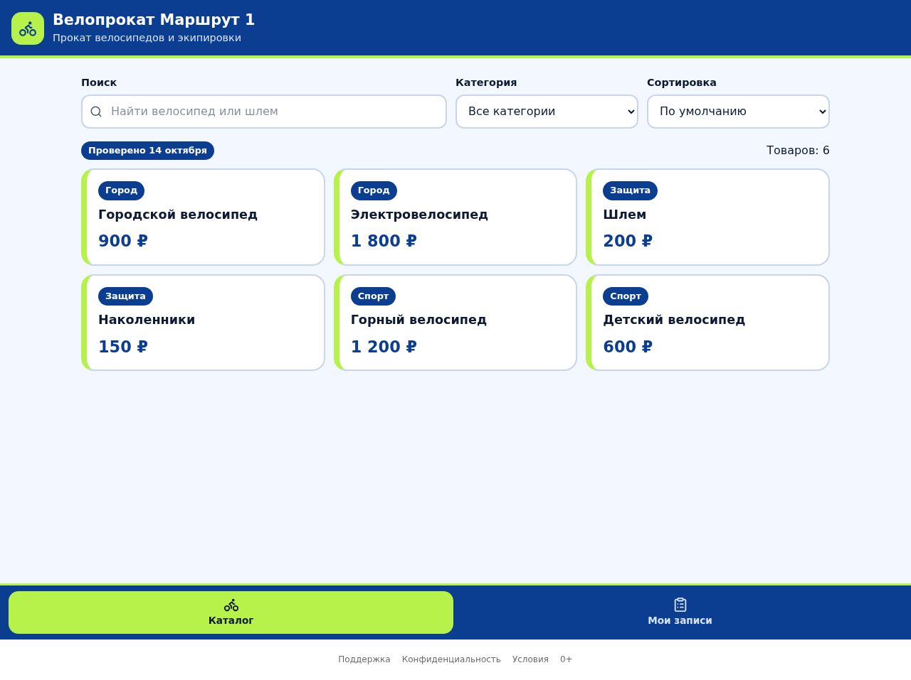
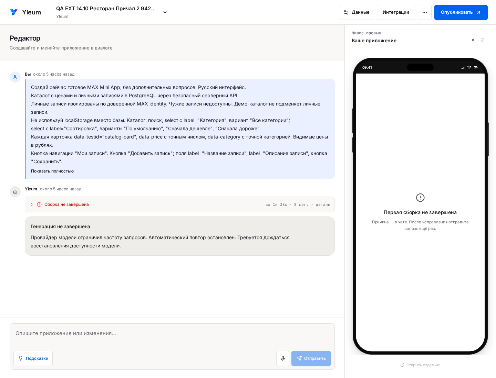

# Проверки генераций Yleum · 14–15 октября 2026

**16 запусков: 12 завершились, 4 — с ошибкой. Это 75% статусов completed, а не доказанная готовность 75% приложений. Цель 99% пока не достигнута.**

Из десяти созданий приложения завершились шесть. Все шесть правок завершились. На точных снимках каждой завершённой правки видны запрошенная плашка «Проверено 14 октября» и начальный счётчик «Товаров: 6». Динамическое поведение проверяется отдельно: наличие текста не подменяет работающую функцию.

[Полный PDF: задания, снимки, действия агента, приёмка, ошибки и расходы](Yleum_Generation_Detailed_2026-10-14_15.pdf) · [Машиночитаемая сводка](evidence-summary.json)

## Что получалось

Этот снимок сохранён для точной принятой версии. В PDF снимки приведены для каждой попытки. «0 ₽» внутри тестового интерфейса относится к внутреннему QA-тарифу; расходы LLM Gateway приведены в реестре ниже. Для неуспешных запусков показан реальный экран платформы; он явно отличается от готового приложения.

## Реестр запусков и стоимость

| № | Тестовый проект | Задание | Результат | LLM Gateway |
|---:|---|---|---|---:|
| 1 | QA 14.10 Кофейня Север | Создание | Завершена | 260,31 ₽ |
| 2 | QA 14.10 Кофейня Север | Правка | Завершена | 53,32 ₽ |
| 3 | QA 14.10 Студия Линия | Создание | Завершена | 458,16 ₽ |
| 4 | QA 14.10 Студия Линия | Правка | Завершена | 36,75 ₽ |
| 5 | QA 14.10 Прокат Маршрут | Создание | Ошибка | 43,34 ₽ |
| 6 | QA EXT 14.10 Велопрокат Маршрут 1 7ed76c | Создание | Завершена | 283,53 ₽ |
| 7 | QA EXT 14.10 Велопрокат Маршрут 1 7ed76c | Правка | Завершена | 45,51 ₽ |
| 8 | QA EXT 14.10 Ресторан Причал 1 ba4667 | Создание | Завершена | 242,06 ₽ |
| 9 | QA EXT 14.10 Ресторан Причал 1 ba4667 | Правка | Завершена | 29,53 ₽ |
| 10 | QA EXT 14.10 Цветочная Лепесток 1 46e834 | Создание | Ошибка | 277,03 ₽ |
| 11 | QA EXT 14.10 Книжный Переплёт 1 afd616 | Создание | Ошибка | 113,69 ₽ |
| 12 | QA EXT 14.10 Фитнес Импульс 1 a27c9c | Создание | Завершена | 278,59 ₽ |
| 13 | QA EXT 14.10 Фитнес Импульс 1 a27c9c | Правка | Завершена | 38,14 ₽ |
| 14 | QA EXT 14.10 Велопрокат Маршрут 2 83ab5e | Создание | Завершена | 256,86 ₽ |
| 15 | QA EXT 14.10 Велопрокат Маршрут 2 83ab5e | Правка | Завершена | 52,73 ₽ |
| 16 | QA EXT 14.10 Ресторан Причал 2 94271f | Создание | Ошибка | 26,85 ₽ — частично |

**Подтверждённые списания этой серии: 2 496,40 ₽ по 327 строкам LLM Gateway.** Пятнадцать генераций сверены полностью. Для последней подтверждено 26,85 ₽ за пять вызовов; шестой зарегистрирован как ambiguous без request ID, его стоимость неизвестна. Частичная сумма не выдана за полную, неоднозначный вызов — за бесплатный.

Сверка выполнена по точному `provider_request_id`, без сопоставления по похожему времени, токенам или цене. Excel провайдера содержит сдвиг столбцов: 12 заголовков и 13 значений; проверены пары «копейки/рубли», уникальность ID и общий итог кабинета. Сырые расходы, ключи и приватные адреса в репозиторий не включены.

Кабинет по всему аккаунту за 14–15 октября показывает 3 999,39 ₽ и 495 запросов, включая другие запросы. Эту сумму нельзя приписывать нашей серии. Остаток баланса после прогона — −0,35 ₽. Во всех сопоставленных расходах фактическая модель — `anthropic/claude-sonnet-5.5`; отдельного сравнения других моделей не проводилось.

## Почему четыре создания оборвались

1. **Первый велопрокат:** ответ LLM не был подтверждён; автоматический повтор остановлен. Три вызова имеют завершённые квитанции. Журнал не устанавливает точную низкоуровневую причину ответа; это не доказательство нулевого списания.
2. **Цветочный магазин:** компиляция остановилась — `src/app/page.tsx` импортирует `./flower.css`, который не найден. Пометка `source-repair:unconfirmed` не подтверждает успешное исправление. Принятого приложения нет.
3. **Книжный магазин:** неподтверждённый ответ провайдера; автоматический повтор остановлен. Все двенадцать зарегистрированных квитанций завершены. Принятого приложения нет.
4. **Второй ресторан:** HTTP 429 и остановка автоматического повтора; один вызов имеет неопределённый результат. HTTP 429 сам по себе не различает нехватку средств, частоту запросов и другие лимиты. Исчерпанный баланс зафиксирован отдельно.

## Соответствие запросу

По каждому запуску PDF содержит матрицу «требование → ожидаемое действие → доказательство → выполнено / расхождение / не проверено». Непроверенное не считается ошибкой модели и не засчитывается как выполненное.

Проверялись точные товары и цены, сортировка, фильтры, создание/изменение/удаление собственной записи, обновление страницы и новый контекст браузера. Дополнительная проверка текущего превью включает поиск, пустой результат, все категории, сброс сортировки, счётчик и клавиатуру на трёх ширинах. Она выделена отдельно: указатель принятого snapshot в БД не является независимым hash-доказательством обслуживаемого runtime.

Для четырёх новых пар build/edit одна и та же контрольная запись сохранила название и описание через AI-правку. В первых Coffee/Salon контрольная запись заранее не создавалась — этот сценарий остаётся непроверенным. В дополнительном текущем превью шесть ранних проверок старой записи у первого велопроката и ресторана получили BLOCKED до загрузки списка. Позднее на сохранённых снимках той же проверки видны ожидаемые название и описание; причина раннего результата — время проверки. Исходные BLOCKED сохранены. Видимый текст не подменяет сверку серверных ID, всего набора данных или точного обслуживаемого artifact. Файлы схемы и миграций совпали во всех шести парах; фактическая историческая схема БД отдельно не сравнивалась.

## Что ещё требуется для стабильности

1. Закрыть неоднозначные ответы и расчёты с провайдером: подтверждённый результат, понятная причина отказа, безопасный повтор только после сверки; отдельно обрабатывать HTTP 429 и исчерпание средств.
2. Не принимать результат с отсутствующим локальным импортом. Проверять исправление, повторную сборку и визуальный результат; пустой CSS ради зелёной сборки не является исправлением дизайна.
3. Сделать проверку буквальных требований частью принятия результата: нужная кнопка должна существовать и выполнять своё действие, счётчик — отражать фильтр/поиск, данные — переживать правку. Общего completed недостаточно.
4. Проверить ресурсную очередь и восстановление превью после простоя. В дополнительном прогоне часть наших QA-приложений ожидала CPU (`waiting_capacity: insufficient_cpu`); это отдельная граница доступности, а не ещё одна ошибка генерации.
5. Закрыть реальные MAX A/B, обычное клиентское списание, публикацию и восстановление: пустая версия; совместимые данные при точном AI-free restore; несовместимые данные с `needs_changes` и адаптацией только по явному действию. В этой серии они не приняты.
6. После исправлений провести разнообразный повторяемый набор. Даже 30/30 успехов не подтверждают 99% с односторонней уверенностью 95%; для такой нижней границы нужны как минимум 299 успехов без отказов при выполнении статистических предпосылок.

## Версии и границы доказательств

Проверенная API-ревизия: `06d11e1d83ab322459bd83fa6dd707a171cd9847`; web и локальная версия на момент основной серии: `daf984d82e31adc65a80e19151e9b906560c3c28`. Изменения между ними относятся к web. Отчёт сохраняет эти ревизии независимо от последующей доставки документа.

593 уникальные изолированные регрессионные проверки прошли; CI проверенной ревизии — 10/10. Production smoke имел отдельные MAX health/webhook 404: настроенный canary hostname не соответствует зарегистрированному проекту/домену. Вероятен устаревший canary; удаление проекта или осиротевший ingress не доказаны.

Код приложения платформы в ходе аудита не исправлялся. В GitHub публикуются очищенные доказательства и отчёт; незавершённые проверки и ограничения перечислены явно.
